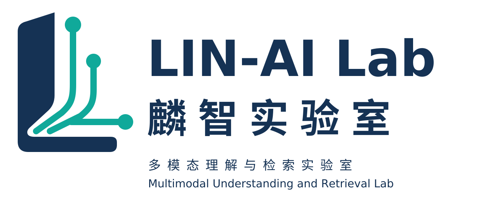

<section id="about" class="intro" aria-labelledby="about-heading">
  
  

    <h2 id="about-heading">About the Lab</h2>
    
The Multimodal Understanding and Retrieval Lab (LIN-AI Lab) was founded at Ningbo University on <time datetime="2026-11-05">November 5, 2026</time>. Led by <a href="/">Bolin Zhang</a>, the lab focuses on multimodal retrieval. We study how a query in one form, such as a sentence, can help us find relevant information in another, such as a video.

    
<em>Bringing talent together, shaping the future through intelligence.</em> 麟聚英才，智启未来

  

</section>

<section id="news" markdown="0">
  <h2>Lab News</h2>
  
<a href="/#news">News from Bolin Zhang’s homepage</a>

  
</section>

<section id="members" aria-labelledby="members-heading">
  <h2 id="members-heading">Lab Members</h2>
  

    <h3><a href="/">Bolin Zhang 张博麟</a></h3>
    
Lab Director

    
<strong>Research interests</strong> · Multimodal retrieval and video moment retrieval from large video collections.

  

  

    
<h3>Students</h3>
Entered <time datetime="2026-09">September 2026</time>

    

      
      

        
          
        
          

        
        <dl>
          <dt>English name</dt><dd>{{ student.english_name | escape }}</dd>
          <dt>Chinese name</dt><dd lang="zh-CN">{{ student.chinese_name | escape }}</dd>
          <dt>Research interests</dt><dd>{{ student.research_interests | escape }}</dd>
        </dl>
      

      
    

  

</section>

<section id="research" markdown="0">
  <h2>Research Areas</h2>
  
  <article class="research-row">
    

      
      <button type="button" hidden aria-label="Play animation: {{ area.title | escape }}">Play</button>
    

    
<h3>{{ area.title }}</h3>
{{ area.description }}

  </article>
  
</section>

<section id="publications" markdown="0">
  <h2>Lab Publications</h2>
  
<a href="/#publications">Publications on Bolin Zhang’s homepage</a>

  

    
View all publications ()

    
  

</section>

<section id="lab-life" markdown="0">
  <h2>Lab Life</h2>
  

    
      <figure><figcaption>{{ activity.caption | escape }}</figcaption></figure>
    
      
      
        <figure class="activity-placeholder">
          
<strong>{{ category }}</strong>Photo to come

          <figcaption>Activity caption to come</figcaption>
        </figure>
      
    
  

</section>
